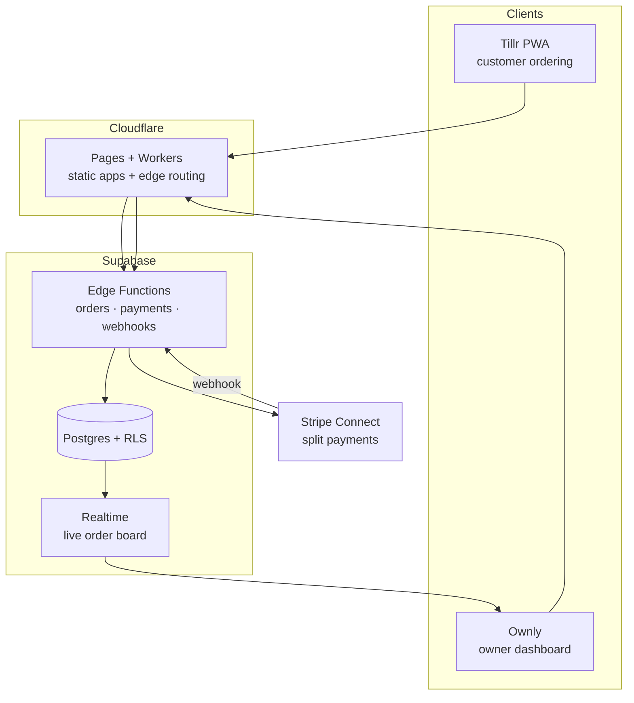
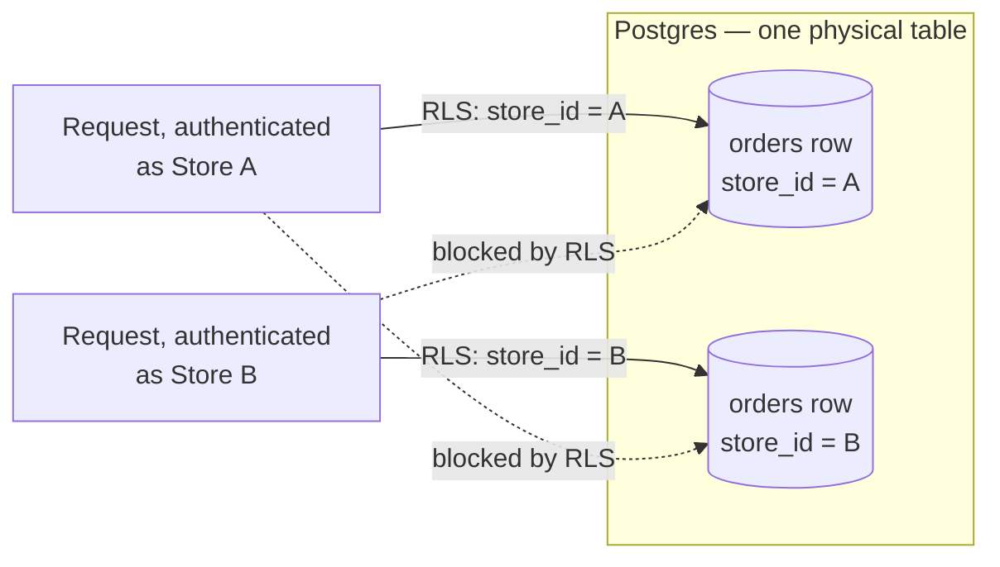
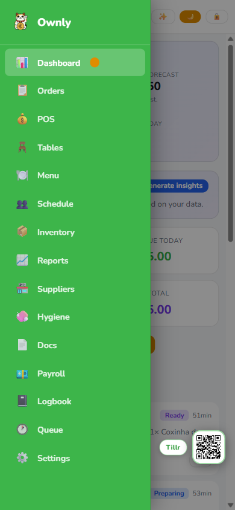
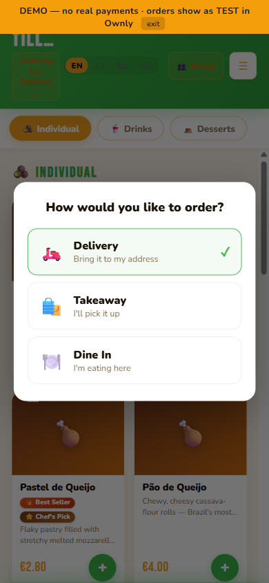

# Lucky Cat: a multi-tenant restaurant SaaS (case study)

A write-up of how Lucky Cat is built. Lucky Cat is a multi-tenant SaaS I designed and built as one developer, directing AI coding agents (Claude Code, Codex).

> Source is private, because it is a commercial product. This is the story of how it
> is built: the problem, the architecture, and the decisions. Screenshots and a system
> diagram, no product code.

## Status

> **Where it actually stands.** No paying customer has ever used it: zero orders, zero
> revenue, no live client. Stripe **is** in live mode and
> the card rail has been exercised end to end with a real €1 payment of my own, but
> that is infrastructure proven, not a customer. Everything below — the architecture,
> the security review, the migration drift — is real work on a real system; what it is
> not is a deployment somebody pays for.

## What it does

Two connected apps on one backend:

- **Ownly** — the owner/manager app: shifts and payroll, stock with auto-deduction, a cash-up flow, and a live orders board.
- **Tillr** — the customer ordering PWA: menu, cart, checkout, and real-time order tracking.

Small restaurants get squeezed between clunky, expensive POS suites and a pile of
disconnected tools (a separate ordering site, a spreadsheet for stock, another for
rota, a card terminal that doesn't talk to any of them). I wanted one system where a
customer's order deducts stock, feeds the owner's live board, and settles a real
split payment — without the owner touching four dashboards.

## Architecture

**One database, many tenants.** The design uses `store_id` and Postgres
**Row-Level Security** to restrict tenant access in the database. Isolation also depends
on the roles, grants, and API paths involved; the [audit](docs/security-audit.md) found a function that
allowed cross-tenant stock changes. The same schema serves a demo store and any
future tenant, selected by an environment variable per deployment.

**Payments on a live rail.** Stripe **Connect** is wired to take the customer's card and
split it — a platform fee to Lucky Cat, the rest to the restaurant — reconciled by signed
webhooks. Stripe is in live mode and the card rail has been exercised end to end with a
real €1 payment of my own. What has not happened is a split settling into a connected
account, because no restaurant has operated on it: the rail is proven, the payout half
is built and untested.

**Edge-first.** The apps are static builds on **Cloudflare Pages**, with backend logic in
**Supabase Edge Functions** and Postgres.

### Tenant isolation, illustrated

*Same table, same schema, every tenant: RLS scopes each row to its store. Functions and
column grants are a separate surface, covered in the [security audit notes](docs/security-audit.md).*

### Stack

| Layer | Technology |
|---|---|
| Database | Postgres + Row-Level Security |
| Backend | Supabase Edge Functions, Realtime |
| Payments | Stripe Connect |
| Frontend | TypeScript / React, PWA |
| Hosting | Cloudflare Pages |

## Screenshots

| Ownly — owner dashboard | Tillr — customer ordering |
|---|---|
|  |  |

## How to read this repo

There is nothing to install, run or test. The repo holds this write-up, two screenshots and a licence.

| Path | What it is |
|---|---|
| `README.md` | This page |
| `docs/decisions.md` | Design decisions |
| `docs/security-audit.md` | What a security audit found, and fixed |
| `assets/` | The two screenshots shown above |
| `.github/workflows/safety.yml` | The merge check, described below |
| `LICENSE` | All rights reserved |

## Pull request safety check

The `safety` workflow runs on pull requests. It fails the PR in three cases:

- a secret is introduced by the PR's commits (checked with gitleaks);
- a changed path matches a rule in `.github/safety-critical.txt` on the base branch. That file is not in the repo yet, so no rule from it applies;
- the PR changes `.github/workflows/safety.yml` or `.github/safety-critical.txt`, once `safety.yml` exists on the base branch.

It never runs the PR's code.

## Deeper docs

- [Design decisions](docs/decisions.md)
- [What a security audit found, and fixed](docs/security-audit.md)

More work: [augustobastos.pages.dev](https://augustobastos.pages.dev)

## Licence

All rights reserved. No permission is granted to copy, modify, distribute or reuse any part of this repository without prior written permission from the copyright holder. See [LICENSE](LICENSE).
